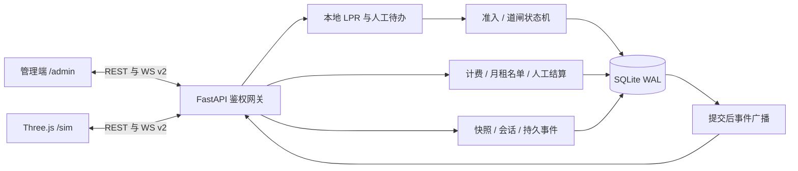

# 系统架构与模块职责

本文件描述修复后的实现；原输入包的设计说明保留为历史资料。

| 目录 | 职责与边界 |
|---|---|
| server/lpr | 本地HyperLPR3 ONNX定位/识别、统一识别管线（原图为主，低置信尝试CLAHE/2x/±3°/bbox变体，最多6个）、语法/置信阈值、读图健康、逐帧日志；`charset.py` 统一 `blue/green/green_large/yellow` 四类车牌（7/8位、严格省份+城市码，`plate_city_codes.json` 31省/406码）；`render.py` 全部走外部 `datasets/external/chinese_license_plate_generator` 的 140 套 blue/yellow/green_car/green_truck 模板+字体（MIT，固定 commit）；视频源抽帧 `server/lpr/video.py`（本地视频/RTSP URL，抽2–5帧融合，P3-06；loopback RTSP 已实测，公网/鉴权未测）；默认演示/历史图片来自`datasets/demo-lpr`（18张四类型）；旧`datasets/plates`合成图库已删除 |
| server/access | 黑名单/余位准入、车位分配、人工待办、缺记录出场、道闸cmd/ack/防砸、反向寻车；`authorize-entry/exit` 人工授权、黑名单 `EntryDenied`（不建普通记录）、`duplicate_entry` 重复派车拒绝、`blacklist-resolution` 后车自动重识别；仿真`source=sim_camera`按`expected_plate`+`sim_conf_threshold(0.85)`先验决策，上传`source=upload`不进入业务 |
| server/billing | 入场费率与权益快照、报价、原子幂等支付、出场结算；demo 模式按 `business_now=epoch+sim` 计费，输出 sim 字段 |
| server/repository | ORM、请求ContextVar会话、写入锁与BEGIN IMMEDIATE、唯一约束、备份与幂等迁移；`entry_sim_sec/exit_sim_sec/duration_sim_sec` 加性列；`server/retention.py` 保留期清理（photos 的 uploads/crops/camera，不碰 datasets/logs/reports） |
| server/state.py | 后端权威演示会话、全局事件seq、车辆/队列/PRNG运行快照、复位、单调度所有者；demo reset force 开放记录 aborted、完成历史保留 |
| server/core/simulation.py | 仿真时钟、暂停/倍率；demo 模式业务时间 `business_now=epoch+sim_time`（暂停冻结），非 demo 回退真实 UTC；speed 0.25–10 |
| server/gateway | REST权限、JWT过期/撤销/Origin、上传限制、认证图片、WS v1兼容及v2持久补发；`/sim/events/arrived-frame`、`/api/recognize*`、`/api/sim/plate-image/dispatch-plan/blacklist-gate/blacklist-resolution`、`/api/admin/scenario`、`/api/manual/authorize-entry/exit/correct-exit`、`/api/demo/reset`（force）、`/api/simulation/control`（0.25–10）、`/api/reports/preview` 与 CSV/PDF 导出、`/api/fee-rules/current`；WS 映射 `entry_denied/exit_authorized/manual_authorized/arrival_retry_requested` |
| web/admin | hash路由、监控/识别/记录/寻车/统计/配置/异常/演示剧本；识别页为上传演示；演示剧本页 t 唯一时间轴/预计入出缴/同牌重叠校验；monitor 设备控制常显（入口/出口道闸抬/落/故障/恢复 + 摄像头故障/恢复）与异常待办；人工授权/纠正只在异常流程出现；force 重置；P3-11 i18n/移动；P2-10 错误卡+Retry；原生ES模块 |
| web/sim3d/js/sim | 路网规划、冲突区预约、OBB安全步进、有限FIFO、场景剧本；LPR 相机截图；P2-17 视觉尺寸；`ScenarioPlayer` t 时间轴/预期/进度（已入场/已出场/总车次）；手动派车 modal；黑名单/授权/重复状态机；事件流解包与未知事件不丢；速度 0.25–10 |
| web/sim3d/js/entities | 车辆正反车牌平面、轮转/转向、道闸动画、占用可视化；P2-17 视觉尺寸；P2-02 出口屏照片；P2-01 闸口屏余位；R-04 视觉-only 偏移；**车牌 UV V 轴修正**；外部模板车牌图；独占资源释放 |
| server/report | PDF/CSV 报表、五周期统计预览（只统计完整进出记录）；`/api/reports/preview`、`/api/reports/export.csv`、`/api/reports/export`；内部需求 FR-6.3 的图表当前只在统计页面，不由 preview PDF 承诺 |
| server/recovery | 启动恢复、异常事件、摄像机故障/道闸断连等恢复辅助 |
| server/layout | manifest 加载/校验、声明式布局生成/迁移、车位坐标派生 |
| server/core | 事件总线、配置、时间工具、领域异常等基础设施 |

数据流程：到达事件携带独立图像与vehicle_id，识别成功后在事务内检查名单/语法/重复/余位并创建在场记录；低置信进入持久待办。前端接到准入和cmd后走真实模型动画，上报同cmd_id的ack以及物理传感器占用、passed/left事实。支付/记录/占用/事件原子提交，广播在提交后执行。观察客户端不能清除其他客户端已上报的占用；占用来源断线保持安全侧，不能靠超时假定车消失。

识别数据与主流程（2026-10-22 更新）：3D 仿真车辆到停止线时，从 manifest `props.lpr_cameras` 的入口/出口相机（FOV30）离屏渲染 **1280×720 PNG**，multipart `POST /sim/events/arrived-frame` 上传；后端保存 `data/photos/camera/`，统一识别后由 `server/access` 按 `expected_plate` + `lpr.sim_conf_threshold`（默认0.85）先验决策——匹配自动放行，否则人工。旧 `POST /sim/events/arrived`（image_path）保留回退。管理端 `/admin/#/recognize` 为上传识别演示：仅调识别/图库/只读日志接口（`/api/recognize`、`/api/recognize/gallery`、`/api/recognition-logs`），`source=upload`、阈值0.85，只展示结果，**无 expected、无入场/放行/记录/车位副作用**。`PlateRecognized` 携带 `image_path/image_url/plate_crop_url/image_source/image_synthetic` 及 `source/expected_plate/plate_match`；3D HUD 与管理端监控显示"识别输入"卡片（相机截图/裁剪/conf/expected/匹配）。车牌贴图为 `datasets/demo-lpr` 的 18 张 MIT 样式图（`assets_3d/plates/` 与 `web/sim3d/assets/plates/`）。`datasets/demo-lpr` 仅演示；EasyPR/treeandgrass 仅用于上传演示验证/可选字符复核，不进入 3D 主流程；PR-2 不属于本轮验收口径。

2026-10-23 批次（架构层变化）：`server/lpr/video.py` + `POST /api/recognize/video` 增加本地视频/RTSP 抽帧融合（P3-06；后续 loopback RTSP 已实测，公网/鉴权未测）；`/api/recognize`、`/frames`、`/video` 写 `recognition_log` 并返回 `recognition_log_id`（上传/多帧/视频均无入场副作用）。布局 API 保留固定网格 409；**2026-10-24 功能重构已删除 C25 预演相关 `POST /api/admin/layout/validate`、`layout_constraints/zone_capacity/runtime_geometry_fixed` 及管理端预演 UI**；P2-07 C25 仍暂缓/部分（当前 80位/每区20）。3D 前端：P2-17 以 GLB Box3 视觉尺寸约束排队/停止线/跟车（OBB dims 不变，三车视觉车距 2.159/1.898m）；P2-02 出口屏显示抓拍照片+费用/余位；P2-01 入口/出口屏显示余位并随 `space_update` 刷新。

2026-10-24 B/C 收尾（架构层变化）：`server/retention.py` + `tools/cleanup_photos.py` 增加 photos 保留期清理（默认 7 天/2 GiB/每目录保留 50 个最新文件/启动+每 6h；只清 uploads/crops/camera，不碰 datasets/logs/reports）；`web/admin` 增加 P3-11 i18n（436 短语/9 页英文/WCAG/≤800px 移动）与 P2-10 统一加载失败错误卡+Retry（monitor/records/stats/fee/layout/lists/incidents/find-car/recognize）；R-04 8 个贴墙边界位视觉-only 偏移 0.12m（视觉越墙 0.1097→0，OBB 不变）；LPR 立杆加入 `static_colliders`（19→21，0.3×0.3m，manifest hash `sha256:593617b665b80945`）；3D LPR 首帧预热（SwiftShader 首抓拍 1012→462ms，生产首车 640ms）。

2026-10-24 功能重构（架构层变化）：**手动派车**改为 3D 面板输入 7/8 位车牌 + `blue/green/green_large/yellow` + 停车时长，调用 `POST /api/sim/plate-image` / `POST /api/sim/dispatch-plan` 获取后端渲染车牌图与 `vehicle_kind`，3D 贴图/选车型并在入库后按仿真时长自动出场；**演示剧本**新增管理端页面与 `GET/PUT /api/admin/scenario`、`POST /api/admin/scenario/reset`，3D `ScenarioPlayer` 消费 `vehicles`（vid/t/plate/plate_type/duration）并显示进度/锁定/重播，默认 6 车覆盖免费/收费/多车/复杂路径；**事件流**为摘要行+`
` 详情；**车牌规范**四类严格校验，`datasets/demo-lpr` 重生成 18 张，HyperLPR 18/18，修复 `Vehicle` 车牌面 UV V 轴倒置；小 bug 一并修复。

2026-10-25 大修（架构层变化）：**车牌渲染**全部切到外部 MIT `chinese_license_plate_generator` 的 blue/yellow/green_car/green_truck 140 模板+字体，新增 `plate_city_codes.json`（31省/406合法发牌机关字母）；demo-lpr 18 张重生成，2D HyperLPR **18/18**、3D 入口 **18/18**/出口 **18/18**/后牌 **6/6**/动态 6 牌 **12/12 exact**。**仿真业务时间**：demo 模式 `business_now=epoch+sim_time`，记录/报价/待办/人工时间按仿真时间，新增 sim 字段，`created_at` 真实墙钟，speed 0.25–10、暂停冻结。**重置/CLI**：`/api/demo/reset {force}` 开放记录 aborted/完成历史保留/pending rejected/车位释放/新会话；`tools/run.py --reset/--resetdata`。**人工授权/黑名单**：`/api/manual/authorize-entry/exit` 替代裸抬杆；黑名单不建普通记录，仅 incident/recognition + resolution 审计，后车自动重识别；重复派车 409 `duplicate_entry`。**剧本/UI**：t 唯一时间轴/预计入出缴/默认 6 车源 JSON `t+duration` 合计 2520s，当前 HUD/播放总长 2529s；手动派车独立 modal、5 面板拖拽/最小化/持久、事件解包、速度 0.25–10。

2026-10-26 收尾（架构层变化）：黑名单改走真实闸杆路径 POST /api/sim/blacklist-gate（无后车入口杆保持 CLOSED/倒车离场；有后车入口 OPEN→场内绕行→出口 OPEN→离开→双杆 CLOSED；不建 parking_record，仅 incident/recognition/blacklist-resolution/blacklist_gate 审计）；闸杆命令/状态新增 manual/passable/authorization，物理可通行≠业务授权；出口待办 manual/confirm 改为实际结算（已有记录按正常费用 charge/free/void，35 分钟 ¥5.00）并开出口；manual/authorize-entry|exit 保留；3D wait_entry 要求 spaceNo+入口 passable，wait_exit 要求 exitAuthorized+出口 passable；重置 force 清场、出口摄像头故障/恢复、剧本下一事件合并预计出场/缴费；admin 正常态无大段人工区、异常卡按故障/待确认显示、事件视图解包 data/payload 且未知事件不裸 JSON。

2026-10-31 最终（架构层变化）：`server/access` 出口识别成功即写 `exit_photo` 并 `_auto_settle_exit`（`method=auto`，含 0 元 PaymentRecord）→ out/释放/开闸；无记录转 `exit_without_record` 人工。新增 `POST /api/manual/correct-exit` 纠正开放记录车牌/入场 sim 时间后自动结算；无记录 auto 409、free/void 人工兜底；黑名单出场 0 费用/0 普通记录（遗留记录 abnormal 审计）。`billing.pay` 幂等兼容，剧本 pay 不阻塞。管理端设备控制卡常显 12 个物理按钮（入口/出口道闸抬/落/故障/恢复 + 摄像头故障/恢复），人工业务只在异常待办出现；事件流 `event-view` 解包/未知不裸 JSON/删冗长文字。仿真端 finished 后暂停仍可用（冻结/继续/重播）；13 车型×前后牌×入口/出口 52 矩阵未复现翻转，正常入前/出后 13/13 exact，未改 `Vehicle.js`。测试：pytest 408、CI 408/1.3693s、Node sim 60/route32/admin20、E2E23/23。

2026-11-04 收尾（架构层变化）：3D 暂停语义修复（未播放暂停不启动剧本，finished 后暂停/继续/重播可用）；新增任意车辆跟随（含 parked，目标离场保持最后位置）；`duration` 统一为入口道闸→出口道闸总时长，`scheduledExitAt=entryGate+duration`、`autoExitAt=entryGate+duration-exitTravelEst`，默认 6 车总长 2529s。管理端记录详情固定中文计费字段/支付方式翻译/历史费率标注；费率页只显示当前费率 + 只读历史（effective_to）；新增统计报表预览 `/api/reports/preview`（day/week/month/quarter/year，只统计完整记录）与公开 CSV/PDF 导出。测试：pytest 419、CI 419/0.9303s、Node sim94/route36/admin28、E2E23/23、N1/N2/N3 全 PASS。

2026-11-06 收尾（历史；架构层变化）：管理端人工抬杆改为 **hold/keep_open 保持**（`manual_open`/故障人工抬杆持久保持，跨 `keep_open_sec` 不自动落，需手动落杆且杆区有车 409；黑名单/普通业务仍自动落杆）；footer 仅 `v1.0.0`；仿真 HUD 下一事件拆两行完整显示（`#scn-next-event/#scn-next-forecast`，normal wrap 无 ellipsis）；管理端报表表格固定列宽/对齐、五周期基准控件（day/week/month/quarter/year）与预览/CSV/PDF 同 anchor；PDF day/week 横向 A4+CJK Paragraph+LongTable 重复表头，月/季/年纵向，支付方式中文、区间可读。测试：pytest 428、CI 428/1.3596s、Node sim95/admin29、E2E23/23、P1/P2/P3 全 PASS。

2026-11-07 修复 A（历史）：pytest 437；M1 季度 CSV 改读 `months`（表头 月份/进场车次/出场车次/营收）；H2 每日封顶固定 UTC+8 自然日；H3 入口授权 after-commit 开门失败改为有限重试 + `IncidentRaised(kind=barrier, reason=authorization_callback_failed)` + OpLog，记录/车位不回滚；H4 `/sim/events/left` 按 vehicle_id/plate 幂等收尾 open 记录（已支付→out/`vehicle_left_after_payment`，未支付→abnormal/`vehicle_left_without_exit`+incident，车位释放一次）；H1 公开导出保留设计；M2–M8 为已知限制，见 docs/08、docs/09。Node/E2E 未改业务，95/30、23/23；报表导出 lang 见 docs/02/12。

2026-11-08 修复 D + 报表双语：pytest 451；M2 重复/迟到出口 120s 幂等（返回 settled/idempotent，不生成 pending/incident）；M3 保留期清理后 `parking_record` 四列照片/裁剪引用置 NULL（`record_refs_cleared`）；M5 preflight 校验外部中文车牌模板文件/可导入；M7 PDF 导出改唯一临时文件+原子 rename+响应后清理；M8 demo_mode 非 loopback 启动拒绝（仅 `PARKING_ALLOW_EXPOSED_DEMO=1` 可显式放行）；M4/M6 仍未修；H1 公开导出保留。Node/E2E 未改业务，95/30、23/23；报表导出 lang 见 docs/02/12。

车辆仅在仿真端推进，姿态/路径/剩余队列约1.5秒上报，刷新只保证已上报的运行快照，不保证刷新前最后一帧。每会话一个驾驶者，其他端可观察，竞争返回409。实际160条运行时道路计划反向共线0、对向中心距3.25m（van净距1.25m），区外交叉0；满停79邻车的160条进出库路线最小净距0.396m。整翼/转向预约继续保护入库倒车与出库机动。全碰撞测试为车身OBB代理，不能证明所有GLB外饰细节无穿插。

数据库/服务部署边界：单进程单 worker；SQLite WAL 配合应用锁适用于本系统负载，不是多 worker 或分布式锁。建模源与GLB、纹理、layout manifest全部只读。

