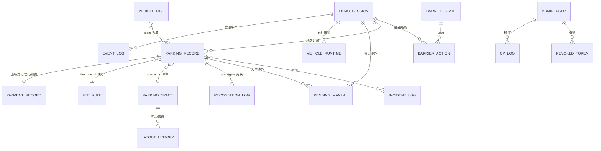

# 数据库 ER 与迁移说明

当前数据库为 SQLite（SQLAlchemy ORM，WAL），模型唯一事实源为 `server/repository/models.py`，共 **18 张表**。应用启动时 `server/repository/db.py` 负责建表/加性迁移/索引/备份相关初始化。

## 1. 表分组

| 分组 | 表 | 主要用途 |
|---|---|---|
| 业务核心 | `parking_record` | 进出/在场记录、照片、费率快照、sim 字段 |
| 业务核心 | `payment_record` | 支付/自动扣费；一单一付 |
| 业务核心 | `fee_rule` | 费率版本；历史版本按 effective_from |
| 业务核心 | `parking_space` | 车位坐标/状态/当前车牌 |
| 业务核心 | `layout_history` | 布局声明/摘要/版本 |
| 识别/人工 | `recognition_log` | 识别/修正/失败尝试 |
| 识别/人工 | `pending_manual` | 低置信/无记录/摄像头故障待办 |
| 识别/人工 | `incident_log` | 摄像头/道闸/数据/网络/断电异常 |
| 账户/名单/审计 | `admin_user` | 管理员/操作员 |
| 账户/名单/审计 | `revoked_token` | 已撤销 JWT |
| 账户/名单/审计 | `vehicle_list` | 白/黑/月租名单 |
| 账户/名单/审计 | `op_log` | 人工操作留痕 |
| 演示/事件 | `demo_session` | 演示会话 |
| 演示/事件 | `event_log` | WS v2 持久事件/seq |
| 演示/事件 | `demo_reset_request` | 强制重置幂等记录 |
| 道闸/运行时 | `barrier_state` | 当前道闸状态/keep_open/fault |
| 道闸/运行时 | `barrier_action` | 道闸命令/ack/原因审计 |
| 道闸/运行时 | `vehicle_runtime` | 仿真运行快照 |

## 2. ER 图（逻辑关系）



> ORM 关系为逻辑关系，SQLite 表间未强制外键；一致性由服务层事务/Guard/审计保证。

## 3. 核心字段与索引

### 3.1 `parking_record`

- 字段：`id, plate, plate_color, vehicle_id, entry_time, exit_time, space_no, status(in/out/abnormal), entry_photo, exit_photo, entry_plate_crop, exit_plate_crop, manual_entry, fee_rule_id, benefit_type, temporary, created_at, session_id, aborted_reason, entry_sim_sec, exit_sim_sec, duration_sim_sec`。
- 索引：`idx_plate_status(plate,status)`、`idx_entry_time`、`idx_exit_time`、覆盖索引 `idx_entry_cover(entry_time,exit_time,temporary)`、`idx_exit_cover(exit_time,entry_time,temporary)`。
- 生命周期：入场创建 `status=in`；正常出场置 `out`；强制重置/异常作废置 `abnormal` 并写 `aborted_reason`；历史记录保留，不做物理删除。

### 3.2 `payment_record`

- 字段：`id, parking_record_id, plate, minutes, billable_units, amount_due, amount_paid, method, operator, breakdown(JSON), paid_at, session_id`。
- 唯一约束：`parking_record_id`（一单一付）。
- 索引：`idx_paid_at`、覆盖索引 `idx_paid_at_cover(paid_at,amount_paid)`。
- `method`：`auto/mock_scan/cash/free/monthly`；`breakdown` 为 FeeBreakdown JSON。

### 3.3 `fee_rule`

- 字段：`id, effective_from, created_at, free_minutes, first_hour_price, unit_minutes, unit_price, daily_cap, ne_discount, round_up, operator, note`。
- 历史版本：`effective_to` 由下一版 `effective_from` 推导，不写列；旧记录按 `parking_record.fee_rule_id` 快照。
- 索引：`idx_fee_effective(effective_from)`。

### 3.4 `parking_space` / `layout_history`

- `parking_space`：`space_no PK, zone, kind, x, z, rotation, status, disabled, current_plate`；索引 `idx_space_zone_status(zone,status,disabled)`。
- `layout_history`：`id, ts, operator, decl(JSON), diff(JSON), version`。

### 3.5 `recognition_log` / `pending_manual` / `incident_log`

- `recognition_log`：`ts, gate, image_path, plate, plate_color, char_confs, overall_conf, elapsed_ms, success, manual_corrected, corrected_plate, session_id`；`idx_recog_ts`。
- `pending_manual`：`session_id, gate, vehicle_id, image_path, candidates_json, source_plate, plate_color, recognition_log_id, reason, message, attempts, created_at, expires_at, status, sim_deadline_sec, confirmed_plate, operator, resolution, resolved_at`；索引 `ix_pending_status_expiry`，部分唯一索引 `uq_pending_vehicle_open(session_id,gate,vehicle_id)`。
- `incident_log`：`ts, kind, gate, detail, status, resolved_by, resolved_at, resolution, session_id`；`idx_incident_status`。

### 3.6 账户/名单/审计

- `admin_user`：`id, username UNIQUE, password_hash, role`。
- `revoked_token`：`jti PK, expires_at`。
- `vehicle_list`：`plate PK, list_type(white/black/monthly), valid_until, note`。
- `op_log`：`id, ts, operator, action, target, detail, session_id`。

### 3.7 演示/事件/道闸/运行时

- `demo_session`：`id PK, started_at, closed_at, status, seed, operator, reset_mode`。
- `event_log`：`seq PK, event_id UNIQUE, session_id, name, payload, source, created_at`；索引 `ix_event_session_seq(session_id,seq)`。
- `demo_reset_request`：`request_id PK, request_body, response`。
- `barrier_state`：`gate PK, state, arm_position, keep_open, pending, last_cmd_id, fault, updated_at`。
- `barrier_action`：`id, cmd_id UNIQUE, gate, cmd, reason, operator, status, created_at, acked_at`。
- `vehicle_runtime`：`session_id, owner_id, vehicle_id` 联合 PK，`payload, updated_at`。

## 3.8 事件与驶离收尾

- `event_log` 保存 WS v2 的持久事件（`seq/event_id/session_id/name/payload/source/created_at`）；接收端按 `event_id/seq` 去重并补发。
- `/sim/events/left` 新增可选 `plate` 字段，按 vehicle_id/plate 收尾 open 记录：已支付→out（`vehicle_left_after_payment`）；未支付→abnormal（`vehicle_left_without_exit` 并写 incident）；车位只释放一次，重复事件幂等。
- 入口授权 after-commit 开门失败时记录/车位不回滚，写 `incident_log(kind=barrier, reason=authorization_callback_failed)` 与 `op_log`，供人工恢复；不新增 schema。
- M2/M3/M5/M7/M8 已修复（出口 120s 幂等、照片清理后 DB 引用置 NULL、preflight 外部模板、PDF 唯一临时文件、demo 非 loopback 拒绝）；M4（金额覆盖审计）、M6（SQLite 多 worker 无程序性拒绝）仍为已知限制，详见 docs/08。

## 3.9 出口幂等与照片引用清理

- **M2 出口幂等**：同一 vehicle_id/plate 在 120s 窗口内且无新的 open 记录时，重复/迟到出口事件视为已结算（`status=settled, idempotent=true`），不新增 `pending_manual`/`incident_log`；有新的 open 记录时不按重复处理。记录 `exit_time` 用于计算窗口。
- **M3 照片引用**：保留期清理删除 `entry_photo/exit_photo/entry_plate_crop/exit_plate_crop` 对应文件后，若传入 DB，则把这些字段置 NULL；`RetentionReport.record_refs_cleared` 记录行数。`parking_record` 主体仍保留（状态/时间/金额/审计），照片证据不再悬空。
- **M7 导出文件**：PDF 临时文件不进入业务表，使用 `data/reports` 的唯一临时文件 + 原子 rename；响应后清理，数据库只保留报表数据本身。

## 4. 迁移与兼容

- 当前无破坏性 schema 变更；新增字段/表采用加性迁移（例如 `fee_rule.created_at`，旧库启动自动补列）。
- 旧数据读取：`created_at` 为空回退 `effective_from`；`effective_to` 不存储，由下一版本推导。
- 迁移前必须备份 `data/parking.db` 及 `-wal/-shm`；停服务或使用 SQLite backup API 取得一致副本。
- 旧库审计：`tools/audit_consistency.py` 检查重复在场/车位/支付/占用冲突；发现冲突先按支付凭据/人工审计处理，不删除支付历史。
- 布局迁移：`tools/migrate_layout_v2.py --dry-run` 先演练，再迁移；写 `layout_history`，保留备份。
- 不直接启动旧版代码写新库；回滚先停服务，恢复匹配版本的数据备份+代码。

## 5. 备份、重建与恢复

```sh
# 一致性审计（副本）
.venv/bin/python tools/audit_consistency.py data/parking.db --out audit.json

# 只重置开放记录（保留完成历史）
.venv/bin/python tools/run.py --reset

# 备份→重建库→bootstrap→seed→内置剧本（备份在 data/backups/resetdata-*）
.venv/bin/python tools/run.py --resetdata
```

- SQLite 单进程/单 worker；不要在迁移/重建时并发写库。
- 照片/报表/日志与 DB 分开备份；`--resetdata` 生成 db/WAL/SHM/scenario/manifest/photos/reports/logs 清单与 sha256。
- 恢复时保持 `parking-system/` 与 `assets_3d/` 同级，且恢复的代码版本与 schema 匹配。

## 6. 已知边界

- 不是多租户/多库设计；SQLite 适合单机演示/中小负载。
- 不强制外键，依赖服务层事务与一致性审计。
- 历史事件/照片有保留期和容量上限；长期归档需外部备份。
- 18 表为当前实现完整集合；旧设计文档中的 9 表清单已过时，以本文和 `models.py` 为准。
