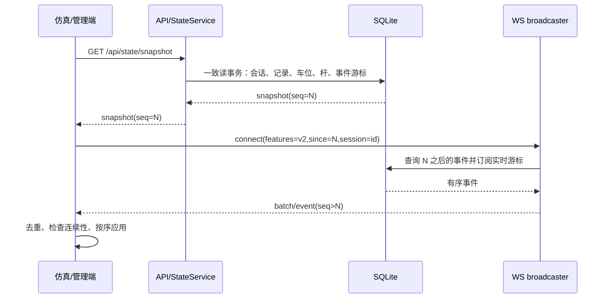

# T1 跨端同步设计

## 目标和现状

后端拥有车位、记录和道闸业务真相。仿真端负责物理呈现，管理端负责监控和人工操作。当前清场只清仿真端，WS 缓冲一次性消费，页面刷新会重播剧本，内存道闸状态无法可靠恢复。设计覆盖 C-03/C-04/P1-06/P2-12/R-05；低置信待办的完整业务由 T2/T6 实施，但快照结构现在预留。

## 关键决策

1. `demo_session` 只标记本次演示的业务归属。旧记录 `session_id=NULL` 视为历史，普通 reset 不自动作废；需先迁移或显式清理演示数据。避免把真实历史车或其他会话清掉。
2. `event_log.seq` 是全局单调序号，`event_id` 是唯一幂等键，`session_id` 标记归属。实时补发不按会话过滤，确保连续序号；会话切换是有序事件。事件表不因 reset 清空，否则断线客户端无法检测换会话。
3. 业务写入与对应 outbox 事件在同一 SQLite 事务提交。现有 `EventBus` 会隔离订阅者异常，不能靠 `EventStore.attach(bus)` 保证“先落库后广播”；服务层通过事务写入 event_log，提交后才通知广播器。广播失败时事件仍可从 DB 重放。
4. 快照读取在单一数据库读事务中完成。道闸控制器的瞬态状态须持久化到 `barrier_state`，不能从进程内对象拼接一个看似一致的快照。服务进程内用写锁串行化状态切换和 `seq` 提交；读快照按数据库提交边界取值。单进程 Uvicorn 为首版部署前提，多 worker 需要另行实现跨进程通知。
5. 复位先检查闸区占用；有车位于杆区时返回冲突，不强制落杆。软复位把当前会话在场记录标 `aborted`、释放其车位、结清本会话未决故障、关闭会话、创建新会话；支付/识别/操作审计保留。硬复位额外删除本会话中未关联支付记录的停车记录；已收费记录及审计记录保留。旧记录 `session_id=NULL` 不处理。复位请求用 `request_id` 幂等。低置信人工待办在 T2 建表后补入复位事务。
6. 新协议以 `features=v2` 协商；旧 WS 消息在迁移期继续发送。新客户端用快照和事件，旧客户端保持现有字段。前端展示只接收同一协议的一份业务事件，避免双发重复。

## 数据模型和迁移

| 表/字段 | 用途与约束 |
| --- | --- |
| `demo_session` | `id` UUID 主键，`started_at`、`closed_at`、`status(active/closed)`、`seed`、`operator`、`reset_mode`；至多一个 active（SQLite 部分唯一索引） |
| `parking_record.session_id` | 新记录必带当前会话；旧值可为 NULL；复位只操作匹配当前会话且 `status='in'` 的记录 |
| `parking_record.aborted_reason` | 复位作废原因；`aborted` 状态在记录页和统计中明确处理 |
| `event_log` | `seq INTEGER PRIMARY KEY AUTOINCREMENT`、`event_id UNIQUE`、`session_id`、`type`、`payload JSON`、`created_at UTC`、`source`；索引 `(session_id, seq)` |
| `barrier_state` | 每闸一行，状态、杆位、故障、pending、`last_cmd_id`、版本与更新时间；仅持久化可恢复状态 |
| `barrier_action` | `cmd_id UNIQUE`、gate、命令、原因、发起方、状态、ack 时间/结果；T3 以此表扩展动作协议 |
| `demo_reset_request` | `request_id UNIQUE`、旧/新 session、结果 JSON，保障网络重试不会二次换会话 |
| `vehicle_runtime` | `(session_id, owner_id, vehicle_id)` 主键；周期保存位姿、阶段、路径进度和持有的冲突区。刷新恢复本 owner 的可控车辆；其他仿真端显示只读镜像并纳入避障 |

迁移先复制数据库到带时间戳备份，再幂等建表/增列/建索引；`create_all` 无法给旧表补列，需显式迁移。迁移前检查孤立在场记录和旧库状态；不隐式清历史数据。Windows/macOS 用 `pathlib` 路径并依赖 SQLite 标准行为。

## 服务与时序

建立 WS 时先注册连接到有序发送队列，再取回放上界并回放 `(since, upper]`，其间新提交事件排队；回放完继续实时发送。连接的最后发送序号确保没有握手空窗或乱序。客户端检测 `seq` 缺口、会话不匹配、游标过旧时重新拉快照；事件只用于更新，快照覆盖完整状态。`GET /api/events` 默认提供全局连续分页补发，`session` 过滤仅供历史列表，不用于同步游标。序号只分配给可对所有授权 v2 客户端发送的事件；敏感 payload 依角色脱敏，但封套仍发送，避免序号空洞。

复位 API 在单个事务中更新记录、车位、会话、杆持久态、待办、审计和 `DEMO_RESET` 事件；提交后广播。所有客户端收到复位事件后丢弃旧会话的本地车辆、预约和剧本状态，再从返回/拉取的快照 hydrate。仿真端不因页面刷新自动开演；同会话可恢复已停车辆和余位，移动中的车辆需有明确暂停/恢复策略，不能凭车位记录重建行驶中位姿。

仿真端每 1.5 秒向 `POST /sim/state` 发送当前 owner 的车辆位姿、阶段、路径进度和预约。快照包含 `vehicle_runtime`，同一浏览器刷新后按 owner 重建路径、位姿并重新申请持有的冲突区；失败时车辆保持停止。其他仿真端轮询快照显示只读镜像，用于可见性与本地避障，不重复上报业务事件。复位在同一事务删除旧会话运行态。浏览器证据在 `_qa_audit/repair/T1/evidence/refresh-smoke.json`，覆盖运动中刷新、双端镜像和双端复位；实车流量下的碰撞/继续行驶长程验证归入 T5。

## 道闸与安全边界

T1 固化杆状态和动作日志，T3 定义 `cmd_id`、顺序、ack、超时和重试；错误 `cmd_id` 的 ack 不改变杆状态。启动先从 DB 恢复可恢复状态，瞬态 `OPENING/CLOSING` 按安全策略进入待确认/故障，不假定动画完成。闸区占用时禁止复位落杆。管理写接口使用现有 `require_admin`；WS v2 通过 `Sec-WebSocket-Protocol` 携带现有 JWT 并校验角色。当前仿真端仍使用演示管理员账号，受限仿真令牌与角色脱敏留待 T4 安全专项收口。

## 回滚与替代方案

迁移为加法，旧代码可忽略新表/列。`server.ws_v2=false` 拒绝新协议连接，需同时部署未传 `features=v2` 的旧客户端；旧 WS 缓冲不提供无损补发保证。回滚代码前先备份数据库，保留 event_log/barrier_action 审计；不要直接删新列或用 `git reset --hard` 清输入包的行尾变化。

备选的“前端清场+重新拉车位”无法清后端在场记录；进程内 500 条环形缓冲不支持多客户端补发；仅靠 EventBus 订阅持久化存在事务边界和异常吞掉问题。因此选择数据库事务内 outbox + 快照/游标协议。
